# Microscope Atlas

**Learn how microscopes work, find the right instrument, and get the numbers right at the bench.**

Microscope Atlas is an open web app for microscopists and lab scientists. It brings together:
- teaching pages for 52 imaging techniques, with light-path diagrams and interactive physics simulations;
- a quiz;
- lab tools for setting up a microscope, planning labelling and making solutions;
- sourced databases of microscope systems, detectors, objectives, light sources, filter sets, fluorophores and papers;
- a page of community resources.

- **Use it online:** the static site is published on GitHub Pages from this repository (see
  [Static site](#static-site)). It needs nothing installed.
- **Run the full app:** it adds tools that need Python on the server, such as reading microscopy files
  (see [Running the full app](#running-the-full-app)).

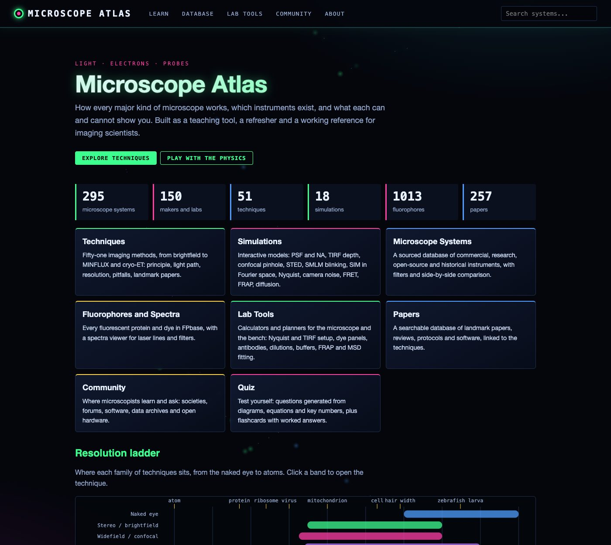

| | |
|---|---|
| **52** techniques with teaching pages, from brightfield to MINFLUX and cryo-ET | **29** interactive simulations running the real equations |
| **37 lab tools** for setup, labelling, bench calculations and analysis | A **quiz** with generated questions and 208 flashcards |
| **452** microscope systems from **220** makers and labs, every entry sourced | **386** papers with Crossref metadata, incl. **142** methods and protocol papers |
| **1,013** fluorophores and **71** spectra from FPbase | **88** checked links to societies, forums, software and data |
| **495** freely licensed images (instruments, micrographs, 290 cell types, calcium movies), each credited | **452** systems with sourced specs and dated sources |

## Contents
- [Techniques](#techniques) · [Simulations](#simulations) · [Virtual optical table](#virtual-optical-table) · [Cells](#cells) · [Microscope builder](#microscope-builder) · [Image Lab](#image-lab) · [Lab tools](#lab-tools) · [Quiz](#quiz)
- [Databases](#databases) · [Community and papers](#community-and-papers)
- [Static site](#static-site) · [Running the full app](#running-the-full-app) · [How the data were gathered](#how-the-data-were-gathered) · [Project layout](#project-layout)

## Techniques
There are 52 methods in eight families:
- transmitted light;
- fluorescence;
- optical sectioning;
- super-resolution;
- functional and spectroscopic;
- label-free;
- electron and probe;
- systems and formats: screening, slide scanners, intravital, miniscopes, adaptive optics and open hardware.

Each page has:
- the physics in plain language, with the key equations;
- an animated light-path diagram drawn for that technique (all 52, from FLIM timing electronics to OCT
  interferometers and head-mounted miniscopes); hover a component to see what it does;
- a step-through walk along the light path: Prev/Next (or clicking a step) highlights the parts of the diagram
  that step mentions and dims the rest; and the numbers worth remembering;
- strengths, limitations, sample preparation, bench tips and the artefacts people actually hit;
- a history timeline and landmark papers;
- the instruments in the database that use it;
- test-yourself questions.

Technique names, glossary terms and software mentioned in the text link to their pages.

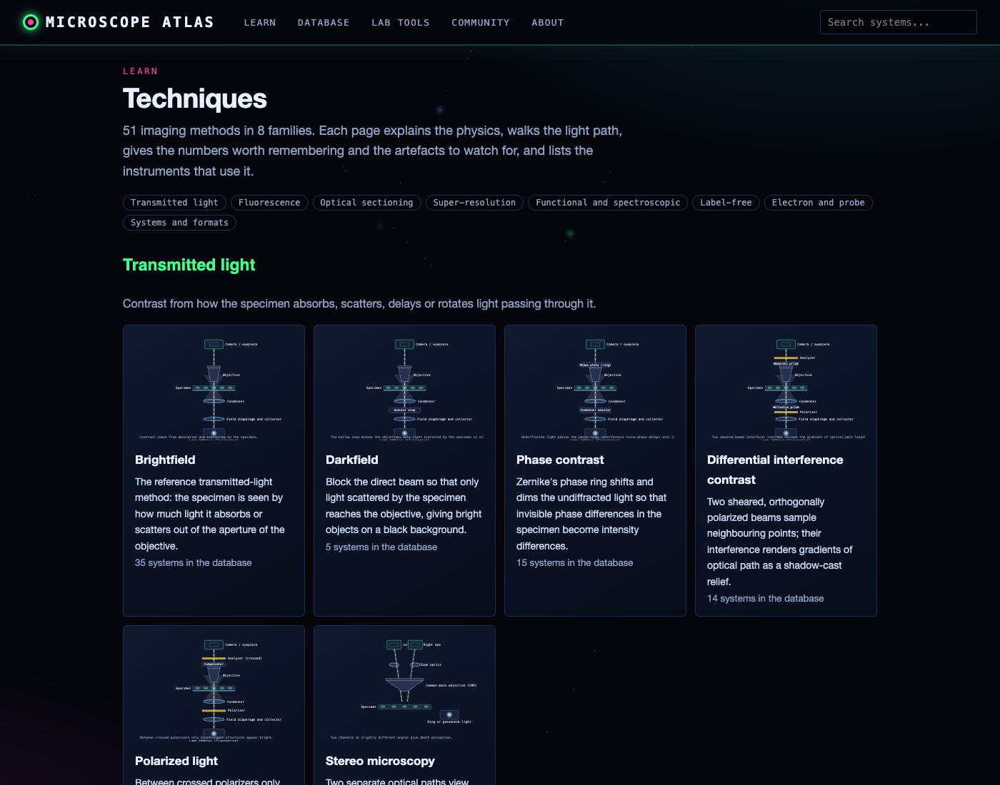

| TIRF | STED |
|---|---|
| 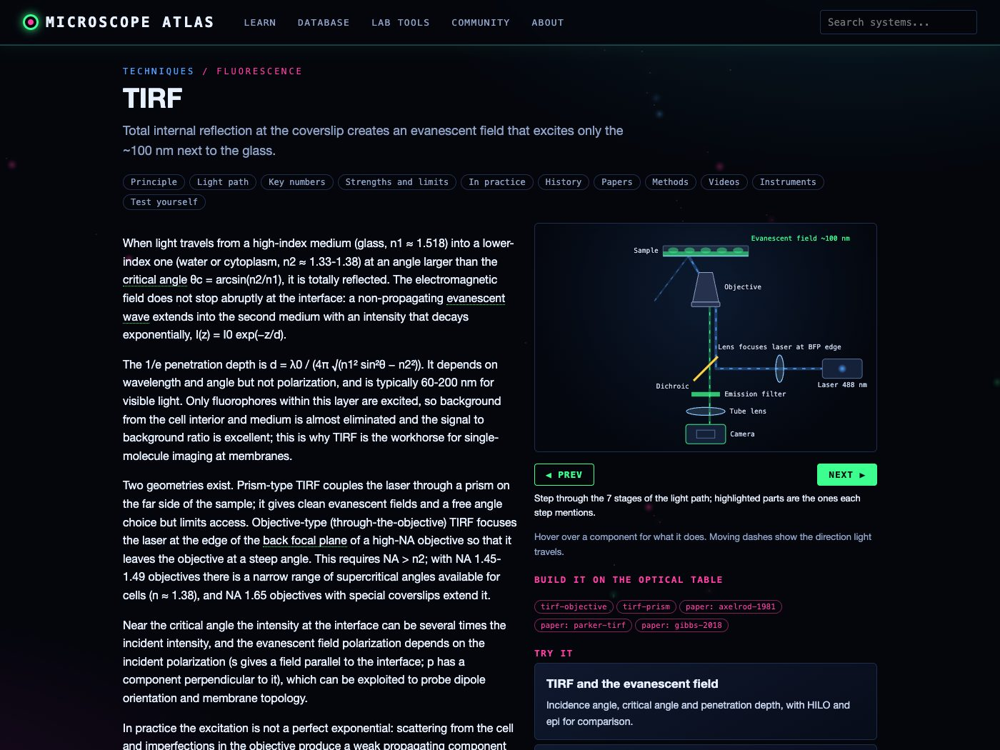 | 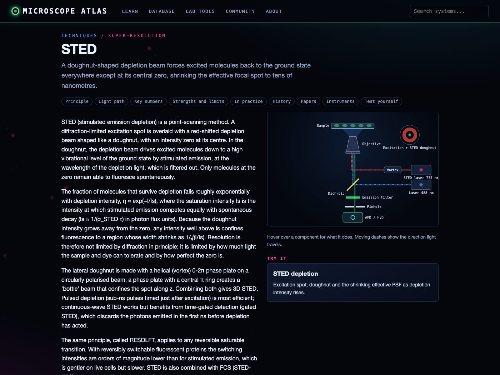 |

## Simulations
All the physics is in one module, `sim_engine.js`. It is tested against known values: Bessel zeros, 83.8% encircled
energy at 1 Airy unit, relativistic electron wavelengths, MSD recovery of D, the Soumpasis half-time, Strehl ratios
against the Maréchal approximation, Richardson-Lucy flux conservation, FLIM phasors on the universal semicircle, the
first CTF zero at 1/√(λΔf), the 1.55× missing-wedge elongation at ±60° (Radermacher 1988), Abbe's λ/(NAobj + NAcond) grating limit, DIC
extinction and bias, G(0) = 1/N and τD = w²/4D recovered from a simulated FCS trace, the 4√(Rr) apparent width of
an AFM-imaged sphere, and the spinning-disk fill-factor floor.

| Optics | Sectioning | Super-resolution | Fluorescence, detection and dynamics | Image processing and electron |
|---|---|---|---|---|
| PSF and the Rayleigh criterion<br>Numerical aperture and immersion<br>Infinity-corrected imaging<br>Nyquist sampling<br>Phase contrast phasors<br>Aberrations, Strehl and adaptive optics<br>Köhler illumination and the condenser aperture<br>DIC shear and bias | TIRF evanescent field<br>Confocal pinhole<br>One- vs two-photon<br>Light-sheet thickness vs field<br>Spinning-disk pinhole crosstalk | STED depletion<br>Single-molecule localization<br>SIM in Fourier space<br>Expansion factor and label displacement | Jablonski and lifetimes<br>FRET ruler<br>FLIM phasor plot<br>Camera noise: CCD, EMCCD, sCMOS, qCMOS<br>FRAP recovery<br>Single-particle tracking and MSD<br>FCS from a simulated trace | Richardson-Lucy deconvolution<br>Electron wavelength<br>Cryo-EM CTF and Thon rings<br>Tomography missing wedge<br>AFM tip convolution |

| Two points and the Rayleigh criterion | Localization microscopy building an image |
|---|---|
| 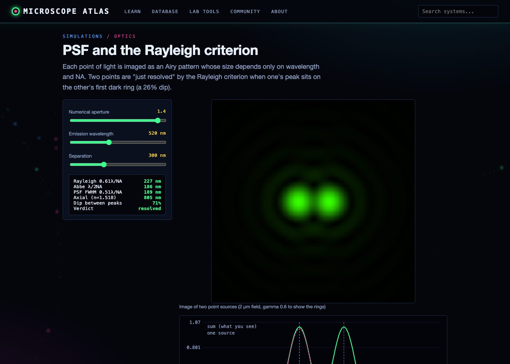 | 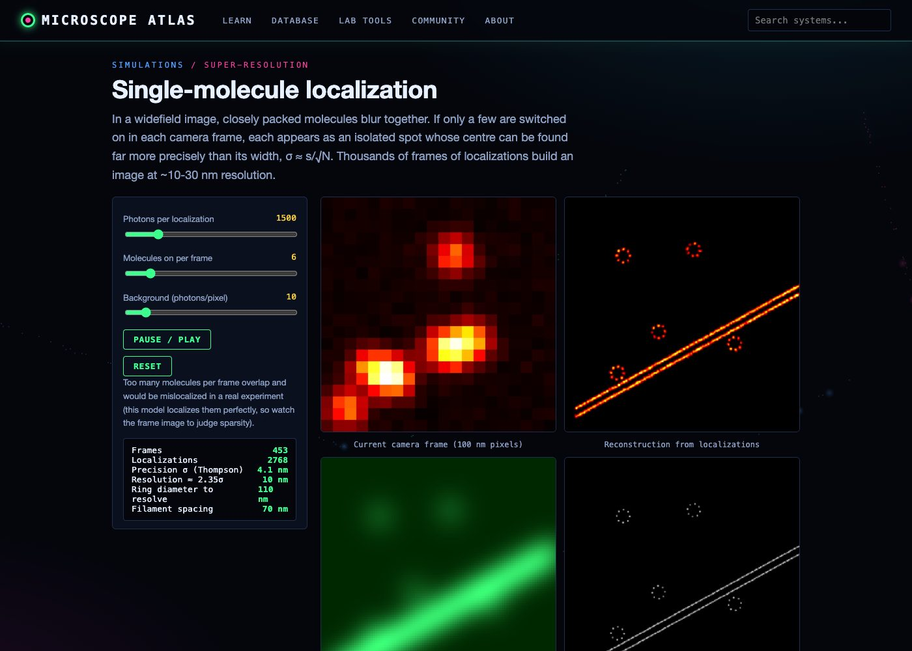 |

| TIRF penetration depth | STED doughnut and effective PSF |
|---|---|
| 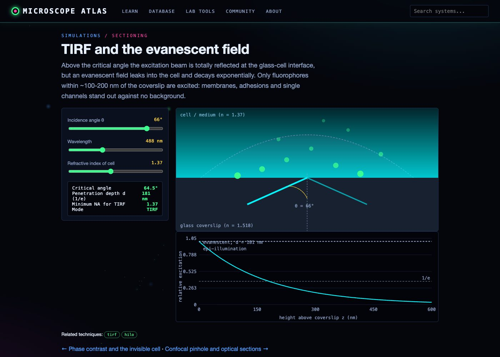 | 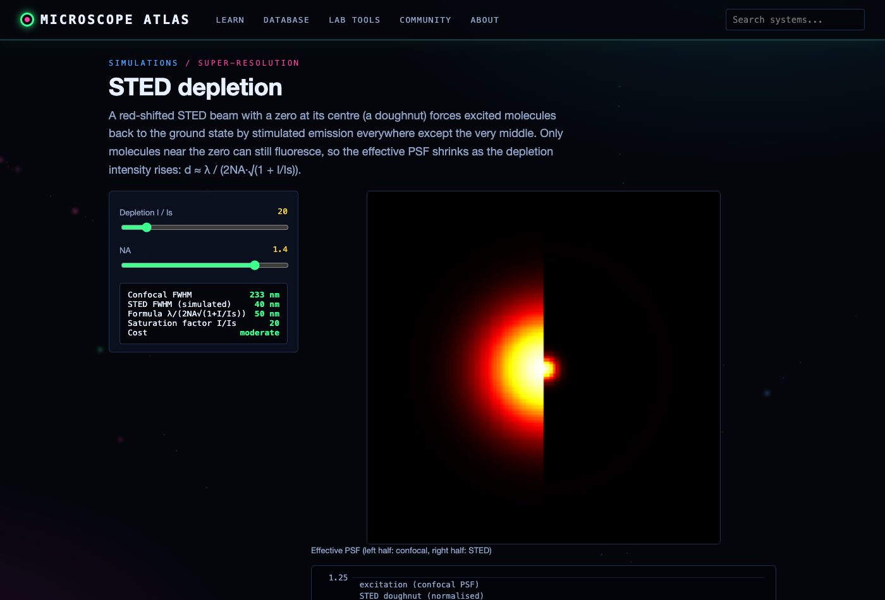 |

| SIM: moiré and extended OTF support | Camera noise at low light |
|---|---|
| 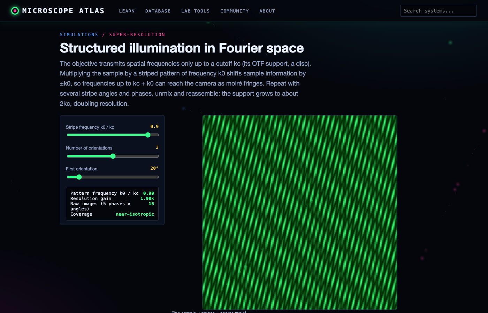 | 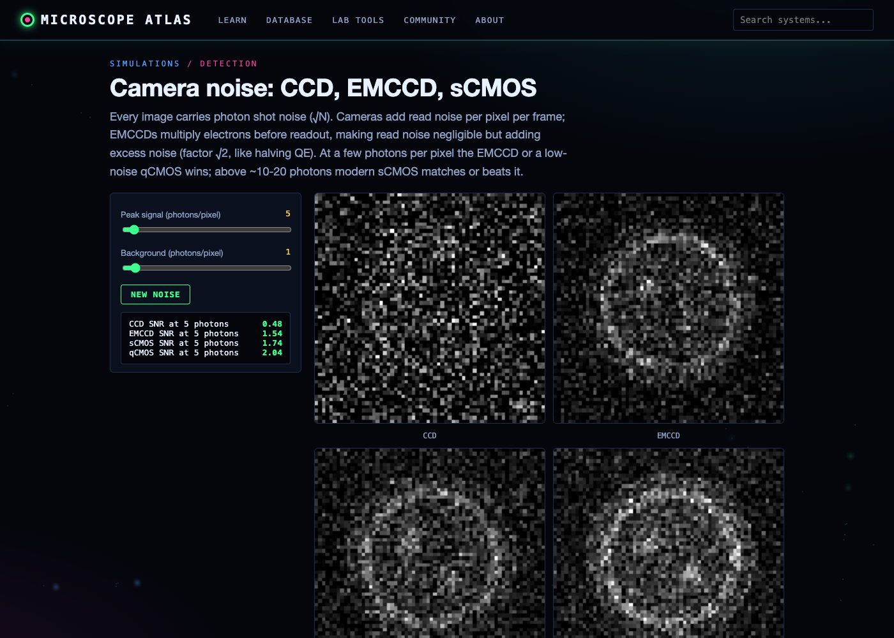 |

| Cryo-EM contrast transfer function | Missing wedge in electron tomography |
|---|---|
| 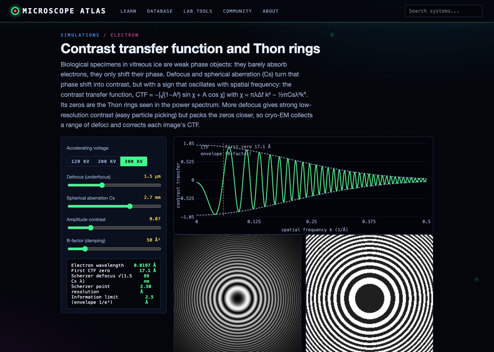 | 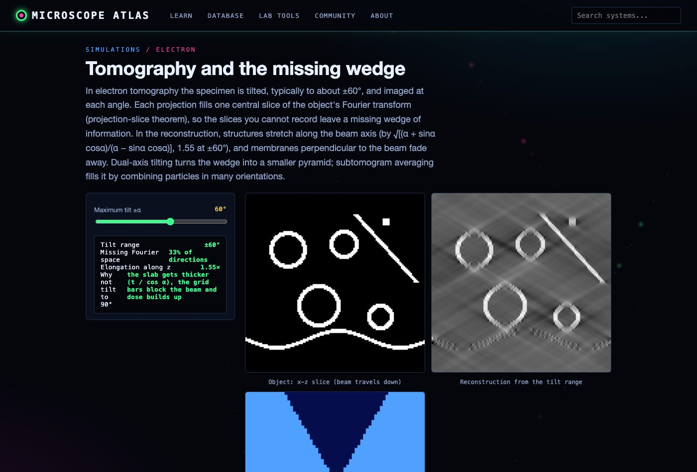 |

| Köhler illumination: diffraction orders and the condenser | AFM tip convolution |
|---|---|
| 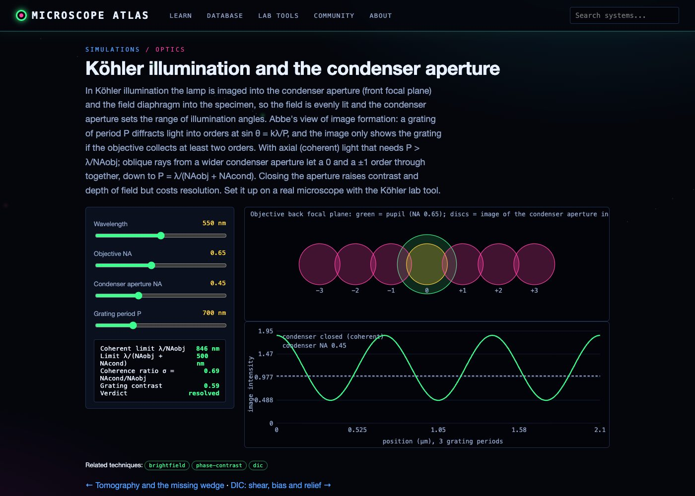 | 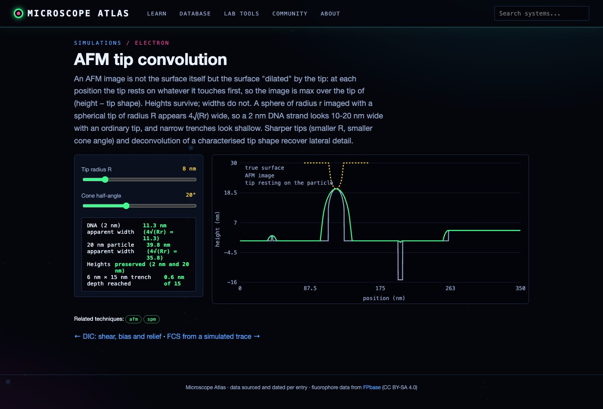 |

## Virtual optical table
Prototype microscopes and laser set-ups on a breadboard with live 2D ray tracing. There are 43 part types:
- sources: lasers, LEDs, lamps, fibres;
- mirrors and scanners: mirrors, galvos, SLMs, DMDs, deformable mirrors;
- dichroics, filters, polarization optics, apertures and pinholes;
- lenses, real objectives and prisms;
- AOTFs and AOMs;
- fluorescent and scattering samples, and a TIRF interface;
- real cameras and point detectors.

Each part explains what it does and links to techniques and suppliers. Readouts give power and spot size, plus
magnification, resolution, Nyquist sampling, TIRF depth and Airy-unit pinhole size.

There are 33 presets, from a 4f relay and interferometers to TIRF, confocal, two-photon, light-sheet, STED and SIM.
Eleven are simplified set-ups from landmark papers and build guides, each cited and with its simplifications stated
(Axelrod 1981, Minsky, Denk 1990, Huisken 2004, OpenSPIM, Gibbs 2018 prism-TIRF, Parker lab TIRF and two-photon,
Hell & Wichmann 1994, Gustafsson 2000, Tokunaga 2008, Dunsby 2008). Layouts can be saved, exported and shared
as links.

**Sample imaging:** put a specimen on the table and every camera or detector shows a simulated image. Specimens
include USAF and Siemens-star targets, bead pairs, microtubules, actin, mitochondria, nuclear pores, single
molecules, DNA-origami grids and Ca²⁺ puff sites. The image is formed by the optics you built: NA,
magnification and wavelength from the trace, and the illumination mode (widefield haze, TIRF, HILO, confocal
pinhole, spinning disk, light sheet, two-photon, STED, raw SIM, brightfield or darkfield). It is sampled by the
real camera, with shot, read and EM noise. The viewer has zoom, colour tables, contrast, histogram, line profile,
scale bar, side-by-side ground truth and PNG export.

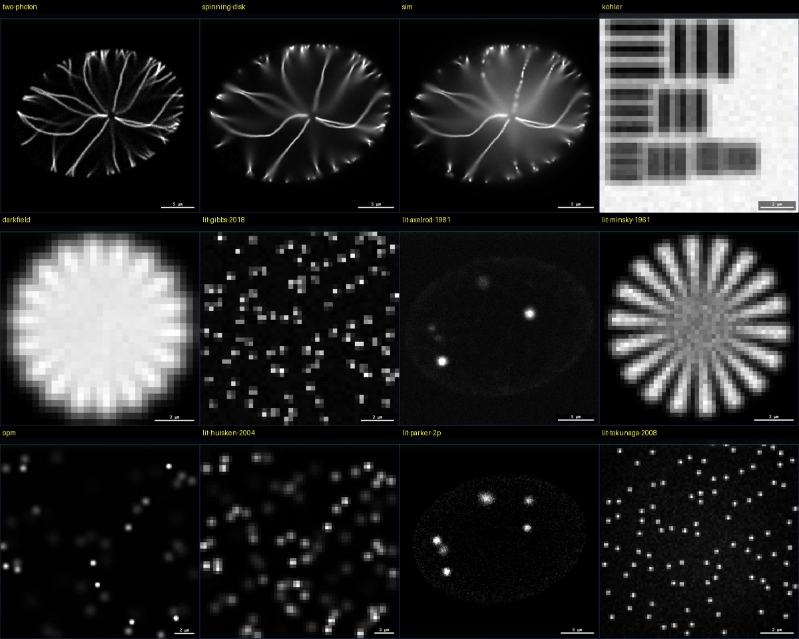

| Objective-type TIRF | STED |
|---|---|
| 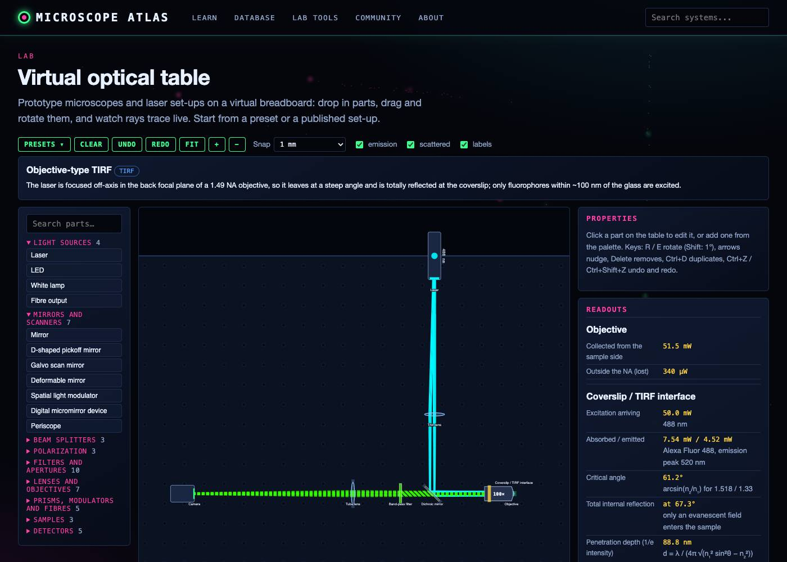 | 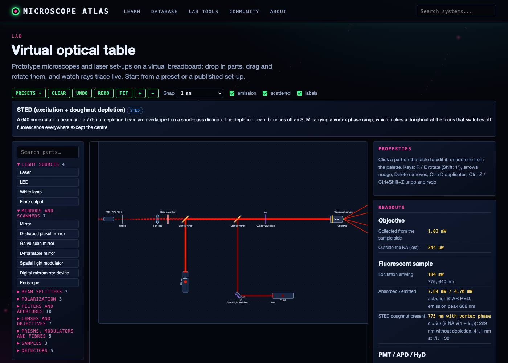 |

## Cells
A page about cells themselves (`#/cells`):
- **Diagrams:** labelled SVG diagrams of ten cell types: animal and plant cells, a bacterium, yeast, a neuron, a red
  blood cell, a neutrophil, a skeletal muscle fibre, columnar epithelium and a sperm cell. Hover a part for its name,
  click it for the structure's entry.
- **Structures:** 22 organelles and structures, each with what it is, what it does, its size, and how microscopists
  see it (dyes, markers, EM).
- **Cell types and numbers:** 34 cell types with features to look for and typical sizes, plus 23 headline numbers.
  Every number cites BioNumbers, Milo and Phillips' *Cell Biology by the Numbers*, the Human Protein Atlas or the
  Molecular Probes Handbook.
- **Image database:** 290 freely licensed micrographs of 34 cell types from Wikimedia Commons, each credited to its
  author with its licence and filterable by cell type and technique. Techniques range from stained histology to
  phase contrast, confocal, SEM and TEM.
- **Identify a cell** (full app): upload an image and a local BiomedCLIP model (Zhang et al., NEJM AI 2025) ranks
  likely cell types. It blends a text-description match with the most similar labelled images in the atlas. It is a
  teaching aid, not a diagnostic tool. The score blends the text match, a classifier trained on
  the atlas's labelled images and the nearest neighbours. Measured leave-one-out on the 290 images, the right type is
  ranked first 33% of the time and in the top three 59% of the time; chance is 3% ([details](docs/cell_id_eval.md)). It needs the optional packages in `requirements-ml.txt`; the model (about
  0.8 GB) downloads on first use.

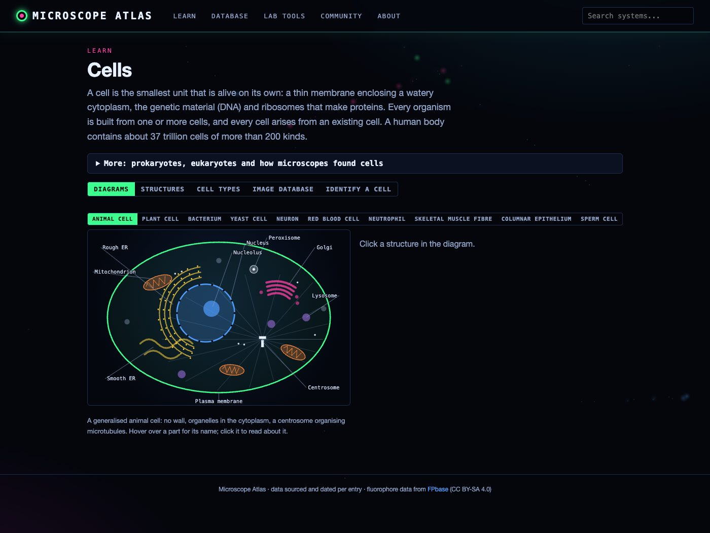

## Microscope builder
Pick an objective, a camera, a light source and a filter set from the components database, one of the 71
fluorophores with measured FPbase spectra, and a line. Choosing a laser engine or LED source offers only the lines it
states, and choosing a filter set takes the emission band the dye would use from that set's emitter. The page also
warns when the line falls outside the set's exciter. The builder reports resolution (FWHM, Rayleigh, axial), pixel size at the sample
against Nyquist, field of view and frame rate. It also follows a photon budget for one molecule, in this order:
power density, absorption cross-section (3.82×10⁻²¹ ε cm²) at the laser line, saturation from the lifetime, quantum
yield, objective collection angle, fraction of the emission inside the filter, transmission and camera QE. It ends
with the brightest-pixel SNR and Thompson localization precision. Specs are read from the database's own text; where a
source gives no QE or read noise, the page asks for the user's value instead of inventing one
(`tests/builder.test.mjs`).

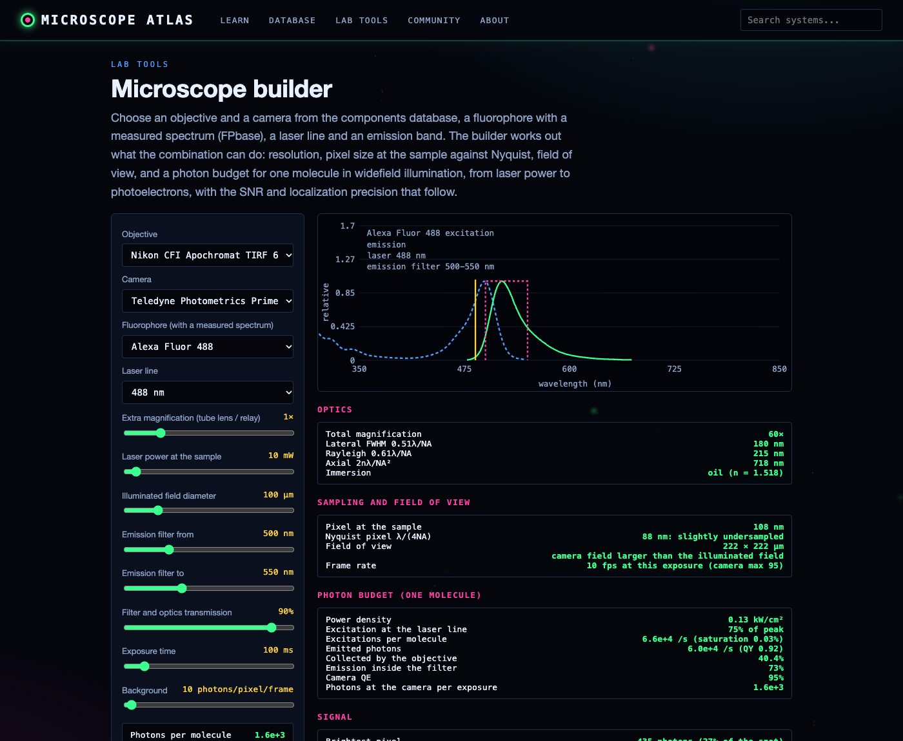

## Image Lab
Load your own image (TIFF, PNG or JPEG; nothing leaves the browser) or one of the test specimens, and image it
through a simulated widefield microscope: diffraction blur from λ and NA, camera pixel size by binning, photon shot
noise, background and read noise, then Richardson-Lucy deconvolution. Power spectra of the object, the camera image
and the restoration show the microscope as a low-pass filter, with the 2NA/λ cut-off drawn as a circle. The readouts
give the PSF width, the camera pixel against Nyquist, peak SNR, and how well each image correlates with the object.
The TIFF reader (8/16/32-bit integer and float, strips or tiles, RGB averaged, PackBits) is checked against
tifffile/numpy in `tests/test_imagelab.py`.

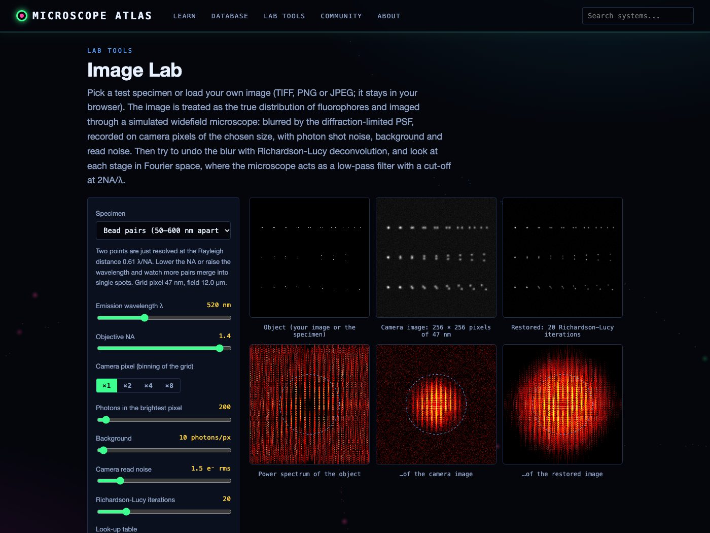

Below, **Localize spots** finds isolated spots and fits each with a 2D Gaussian (Levenberg-Marquardt), reporting
photons, background, width and position. On the *single-molecule frame* specimen, where the true positions are known,
it reports found/missed/false spots and the error against the Thompson-Larson-Webb (2002) precision; at 100 nm pixels,
~900 photons and 10 background photons per pixel the error is about 4 nm, as predicted. Fits agree with
`scipy.optimize.curve_fit` to 10⁻⁴ (`tests/test_imagelab.py`).

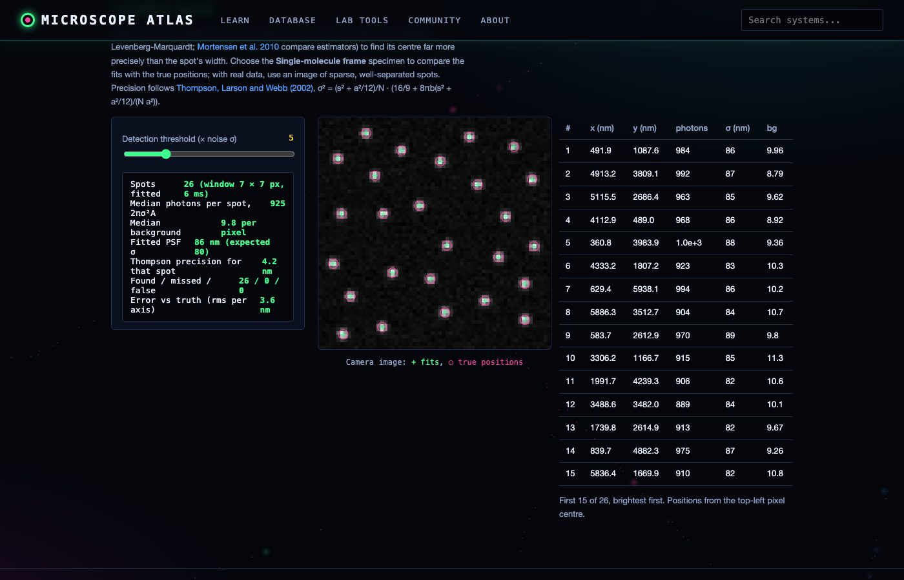

## Lab tools
These are calculators, planners and reference tables for people at the microscope and the bench.
- **Microscope setup:**
  - Köhler illumination checklist;
  - camera and objective matcher (pixel size at the sample against Nyquist);
  - axial z-step;
  - TIRF beam offset in the back focal plane;
  - laser power density;
  - immersion and mounting-media refractive indices;
  - objective finder;
  - optics calculator.
- **Planning:**
  - acquisition planner (data volume, write speed, sampling in time);
  - light-dose budget;
  - technique chooser.
- **Labelling and probes:**
  - multicolour panel designer;
  - fluorescent protein picker;
  - antibody dilutions;
  - secondary antibody planner;
  - degree of labelling;
  - labelling reactions;
  - tags and probes;
  - fixation and permeabilization;
  - spectra viewer.
- **Bench calculators:**
  - molarity, dilutions, serial dilutions, unit conversions and percent solutions;
  - cell seeding by plate format;
  - hemocytometer counts;
  - RPM to RCF;
  - buffer and super-resolution imaging-buffer recipes;
  - photon flux and Stokes-Einstein diffusion.
- **Analysis:**
  - localization precision;
  - FRET;
  - FRAP fitting;
  - MSD analysis;
  - SNR;
  - a microscopy file inspector (full app only).

Reference values come from cited sources (manufacturers, protocols, papers), linked beside each table.

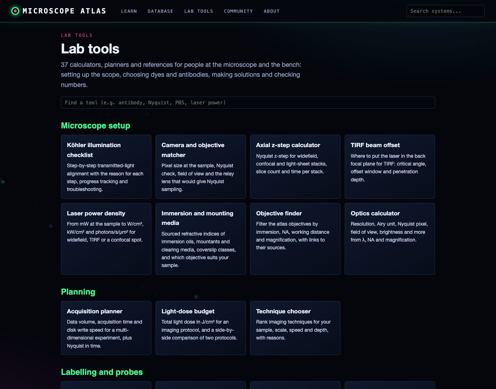

| Spectra viewer | Technique chooser |
|---|---|
| 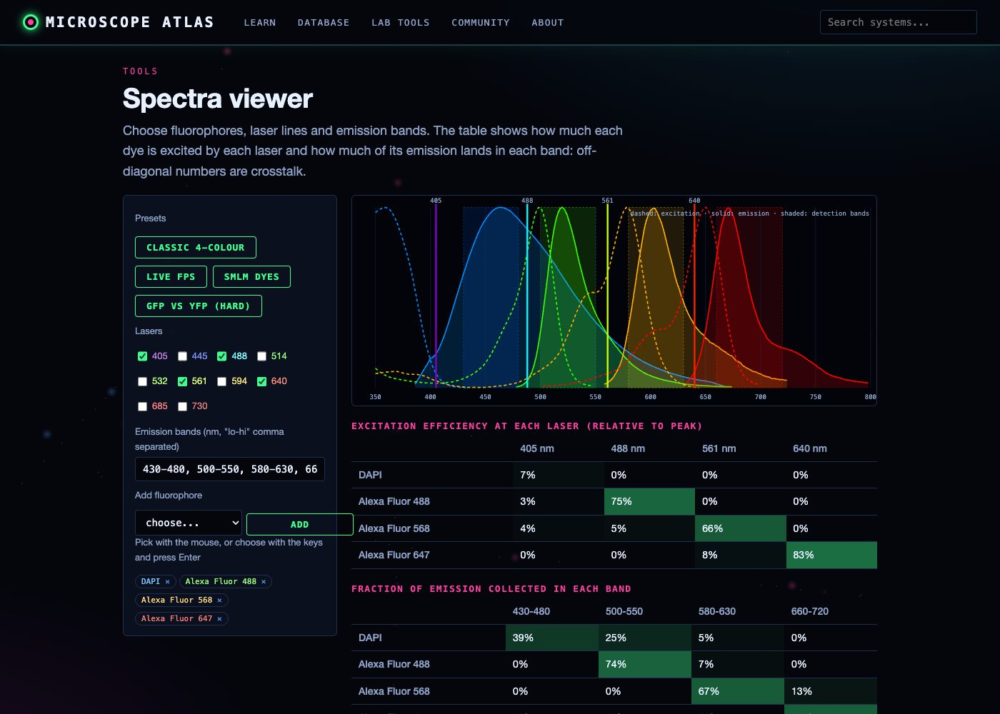 | 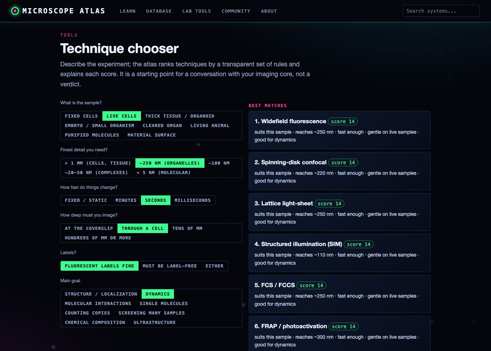 |

## Video tutorials
150 checked video lectures and how-tos (iBiology, Harvard Microcourses, NEUBIAS, EMBL, imaging facilities), covering the original 51 techniques, on a filterable page and on each technique page.

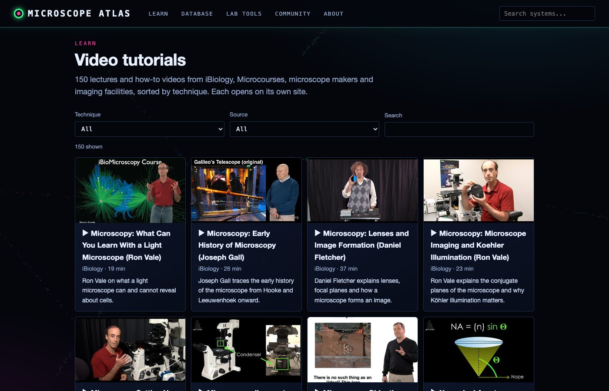

## Quiz
- **Multiple choice:** questions are generated from the atlas itself. Name the technique from its light-path
  diagram, match equations, key numbers, terms and fluorophores.
- **Flashcards:** 208 worked questions with model answers, scheduled with Leitner boxes so missed cards return sooner.
- **Progress:** stored in your browser.

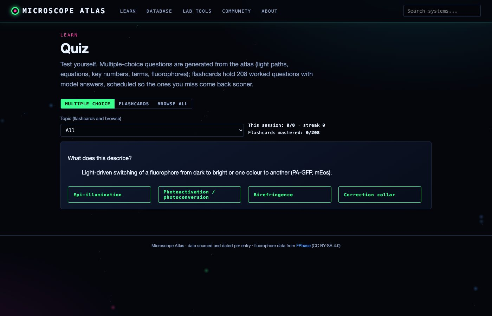

## Databases
- **Microscope systems:** search by technique, family, kind and maker. Each entry has:
  - sourced specifications and resolution;
  - source links;
  - the date the sources were read.

  You can compare up to six systems side by side.
- **Detectors and objectives:** sCMOS, qCMOS, EMCCD, SPAD, hybrid and electron detectors; flagship TIRF,
  silicone, water, multiphoton and cleared-tissue objectives.
- **Light sources (28):** single-line diode and DPSS lasers, multi-line laser engines, tunable and fixed femtosecond
  lasers for multiphoton imaging, a pulsed STED depletion laser, LED engines, white LEDs and arc lamps, each with its
  lines, power, modulation and coupling as the manufacturer states them.
- **Filter sets (33):** Chroma ET, Semrock BrightLine (including the BrightLine 2.0 and LED sets) and Edmund Optics
  sets (single-band, multiband, Pinkel and Sedat), with exciter, dichroic and emitter part numbers.

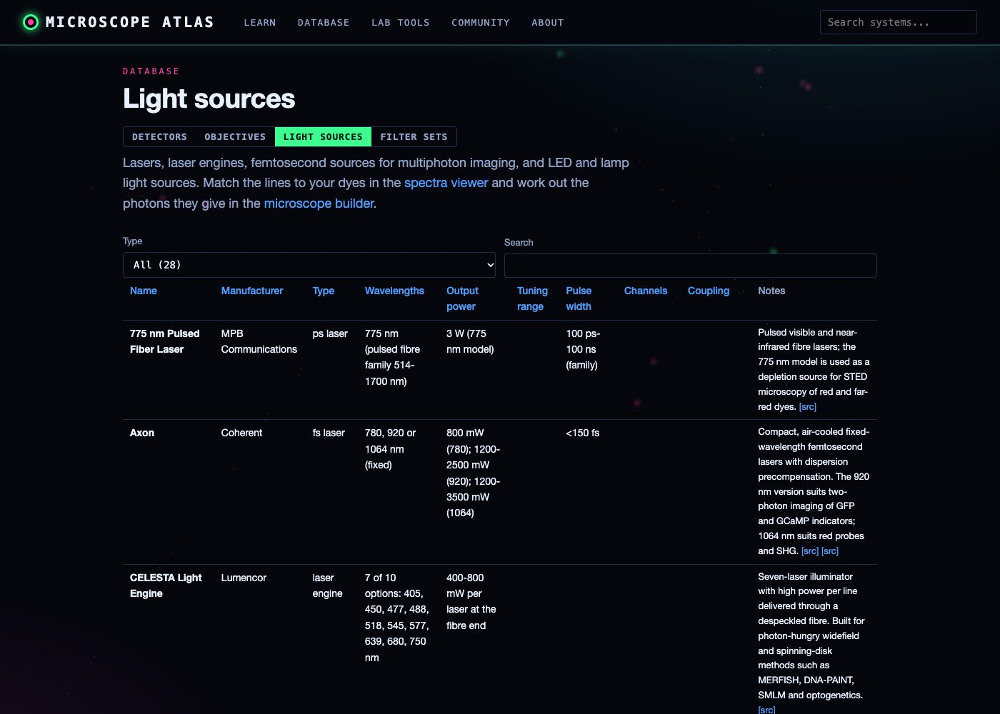
- **Fluorophores:** every fluorescent protein and dye in FPbase, with peaks, brightness, pKa, lifetime and
  maturation.
- **Image gallery:** 200 Wikimedia Commons images (public domain, CC0, CC BY or CC BY-SA): historical and modern instruments, and example micrographs for 42 techniques. Each shows author, licence and source, and appears on its system and technique pages.
- **History:** a timeline of 276 events.

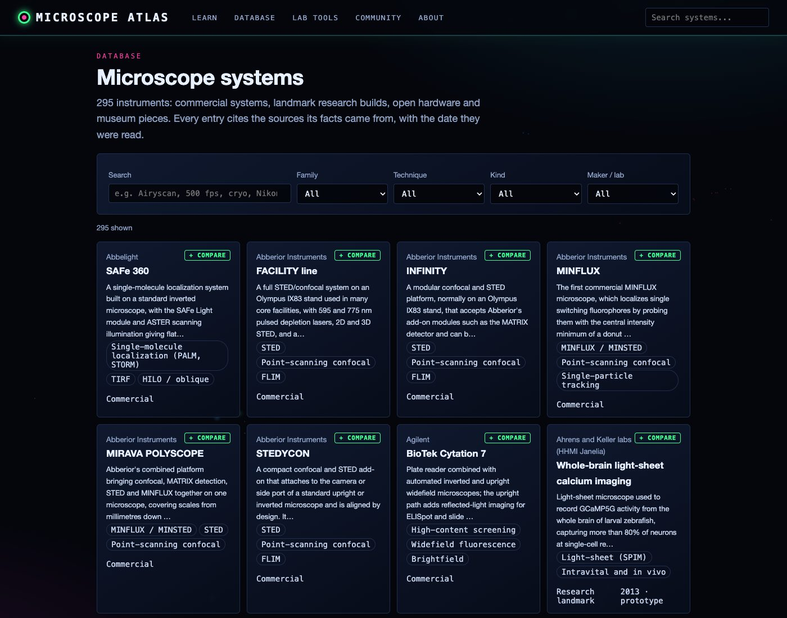

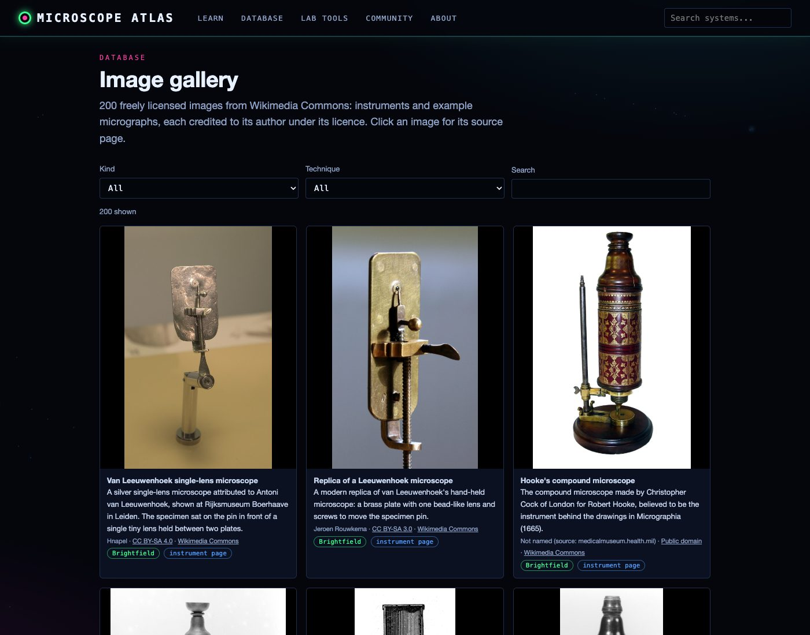

| System detail | Comparison |
|---|---|
| 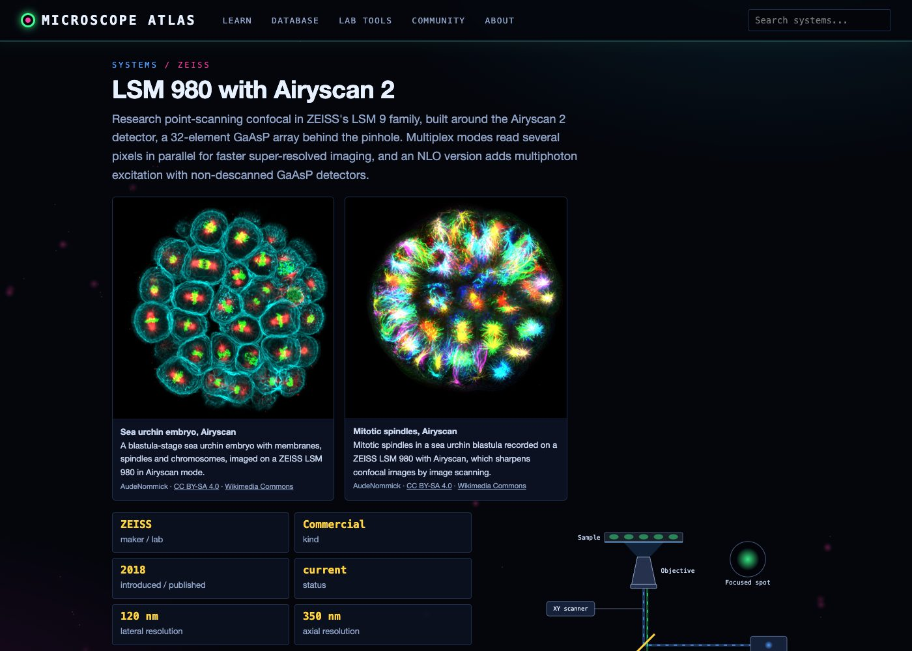 | 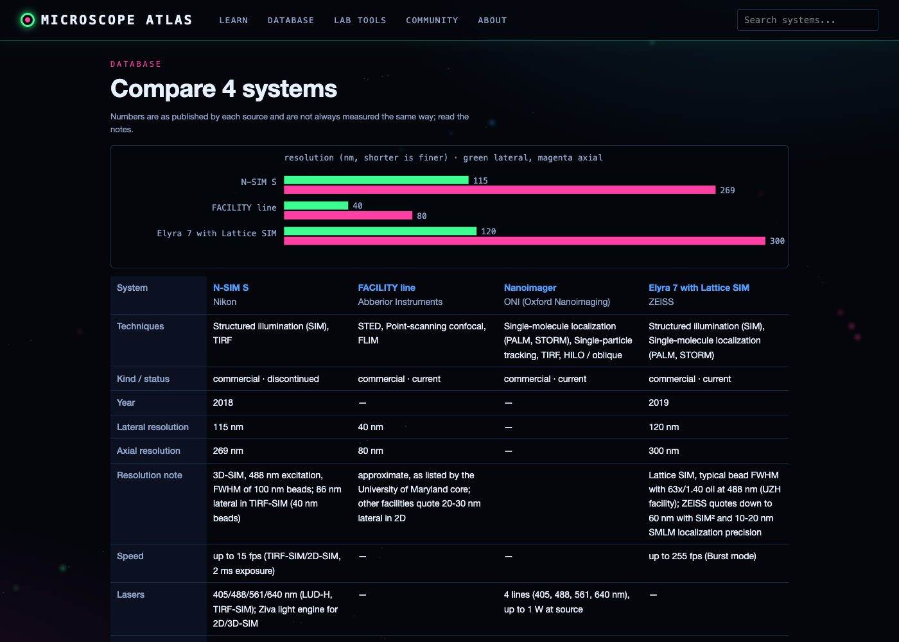 |

## Community and papers
- **Papers:** 386 papers, including 142 methods papers and protocols (at least two for every technique). They include the landmark papers behind each technique, plus reviews, protocols,
  analysis benchmarks, software and guides to rigorous imaging. Each has Crossref metadata and citation counts,
  and can be searched and filtered by technique.
- **Community:** societies, forums, training, image-analysis software, acquisition and data tools, data
  archives, open hardware, and guides to building your own microscope (TIRF, two-photon, light-sheet,
  OpenFlexure, UC2). Every link is checked automatically.
- **Nobel Prizes and the microscope:** 19 prizes (32 laureates), from Koch (1905) and Golgi and Cajal (1906) to
  super-resolution (2014) and cryo-EM (2017). Each is marked as advancing microscopy, as discovered with microscopy,
  or as related imaging (MRI, the CCD). Each carries the official citation from nobelprize.org and a short note on
  the microscopy involved.

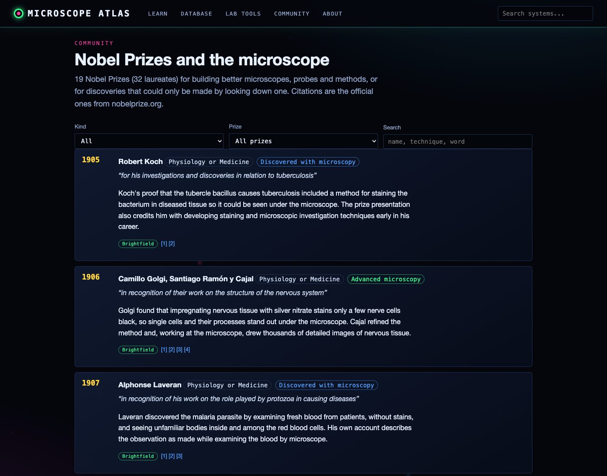

| Papers | Community |
|---|---|
| 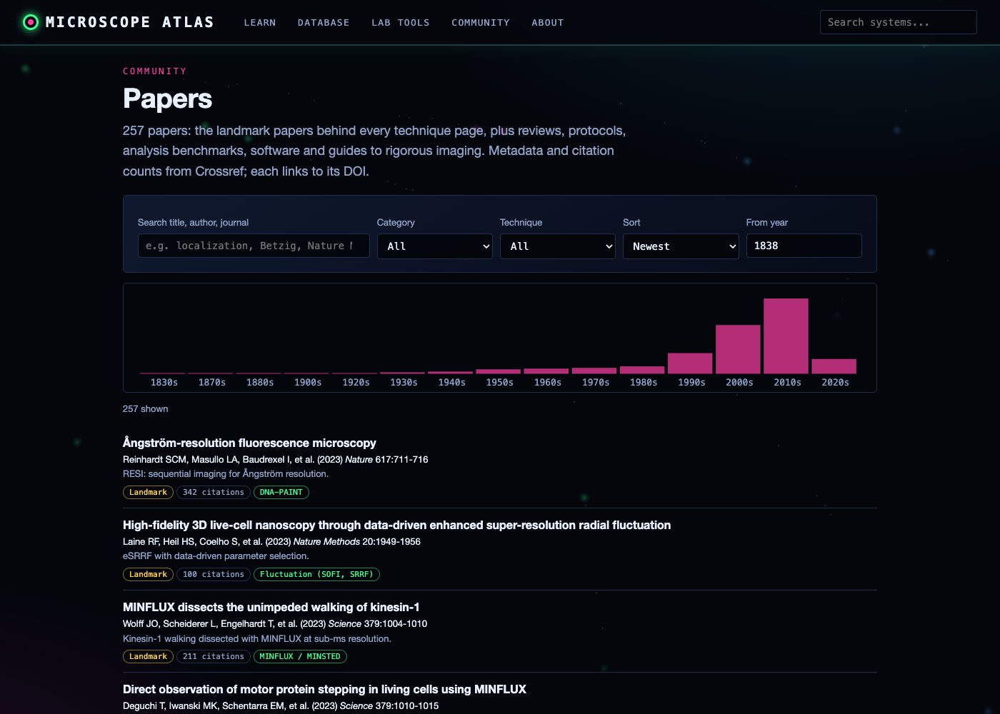 | 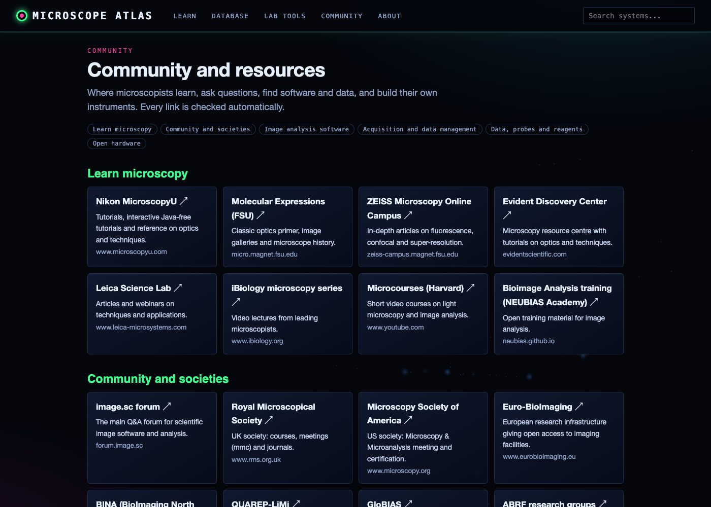 |

## Static site
`scripts/build_static.py` exports the app to `site/`:
- It calls every API endpoint through the real FastAPI app and saves each response as JSON, so the static site
  shows exactly the same data.
- System and fluorophore searches run in the browser (`static_api.js`).
- Tools that need Python on the server show a notice instead.

The workflow in `.github/workflows/pages.yml` runs the data and API tests, builds the site and publishes it to
GitHub Pages on every push to `main`. The output is plain files, so it can be hosted anywhere (any web server,
S3 or Netlify, for example) under any path.

```bash
.venv/bin/python scripts/build_static.py --out site
python3 -m http.server -d site 8080      # then open http://127.0.0.1:8080
```

## Running the full app
```bash
python3 -m venv .venv
.venv/bin/pip install -r requirements.txt
.venv/bin/pip install -r requirements-ml.txt   # optional: cell identification (PyTorch, open_clip)
.venv/bin/python run.py            # then open http://127.0.0.1:8010
.venv/bin/python -m pytest -q tests/
```
- The front end is plain ES modules with no build step.
- Node is optional; it runs the JavaScript tests.
- Google Chrome is optional; with Playwright it powers `scripts/screenshots.py`, the README figures and a smoke
  test of every page.

## How the data were gathered
- **Instruments:** researched from manufacturer pages, datasheets, imaging-facility pages, papers and museum
  pages. Specifications that could not be confirmed were left out rather than guessed.
  - `scripts/validate_data.py` enforces the schema in [docs/DATA_SCHEMA.md](docs/DATA_SCHEMA.md).
  - `scripts/check_links.py --systems` reports dead source links ([docs/link_report_systems.md](docs/link_report_systems.md)).
  - Some facts rest on search-result summaries of the cited pages. An audit against the full pages is on the
    [roadmap](ROADMAP.md).
- **Papers and teaching pages:** DOIs are checked against Crossref.
- **Fluorophores:** data from [FPbase](https://www.fpbase.org) (CC BY-SA 4.0).
- **Images:** from [Wikimedia Commons](https://commons.wikimedia.org); `scripts/fetch_commons.py` re-checks every licence and records the credit shown beside each image.

Corrections are welcome: each record is one line of JSON under `data/`.

## Project layout
```
atlas/            Python: catalogue, content, fluorophores, lab file reader, FastAPI app
atlas/web/static/ front end: pages, light paths, simulations (sim_engine.js), quiz, lab tools, static data layer
data/             systems, components, technique pages, fluorophores, spectra, papers, community (JSON)
scripts/          validation, static export, FPbase, Crossref papers, link checks, content build, screenshots
tests/            data, API, lab-file and JavaScript tests
```
See [INTERFACE.md](INTERFACE.md) for a file-by-file map and [ROADMAP.md](ROADMAP.md) for what comes next.

## Author
Built by George Dickinson, a cell biologist who has been part of quantitative-imaging research teams for twenty years
(TIRF Ca²⁺ imaging, STORM, sptPALM and DNA-PAINT) and now builds analysis software for imaging labs.
Developed with Claude Code. Content is for education; check instrument specifications with their makers.
## Licence
Code and the atlas's own text are under the [MIT licence](LICENSE). Images, FPbase data and other third-party material
keep their own licences: see [THIRD_PARTY.md](THIRD_PARTY.md).
